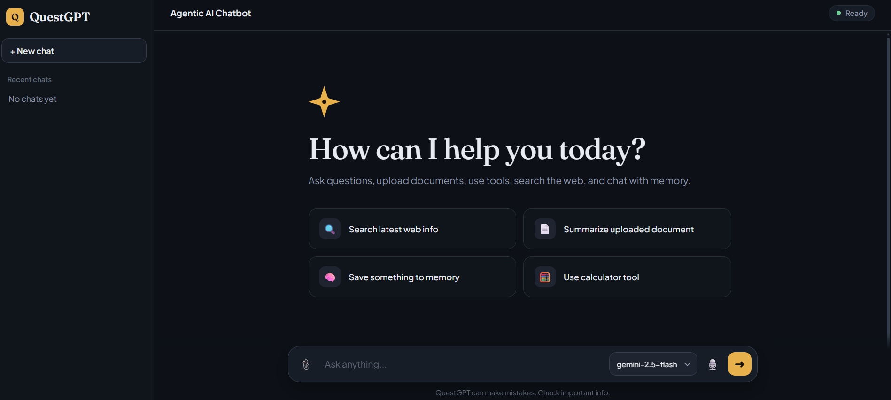
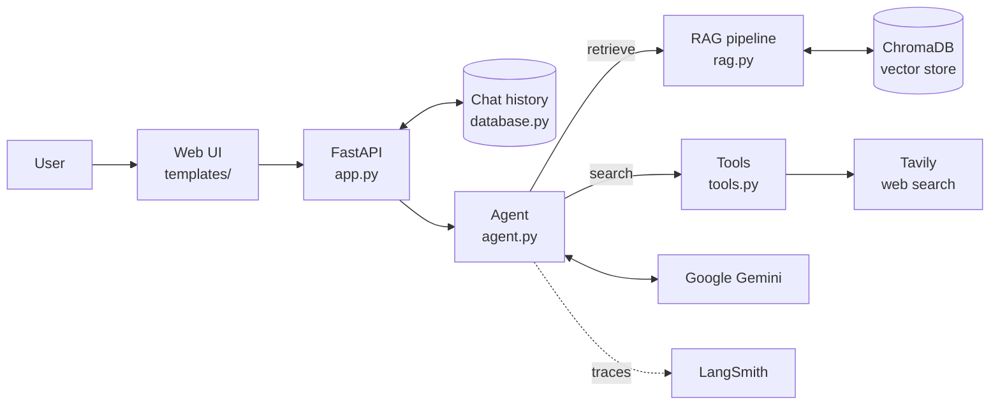

<div align="center">

# 🧭 QuestGPT

### Chat with your own documents. Get answers grounded in facts, not guesses.

An agentic RAG assistant that retrieves from your files, searches the web when it needs fresh information, and remembers your conversations.

<br />


[🚀 Live Demo](https://your-app-name.onrender.com) &nbsp;•&nbsp; [🐞 Report Bug](https://github.com/Pratik5767/QuestGPT/issues) &nbsp;•&nbsp; [💡 Request Feature](https://github.com/Pratik5767/QuestGPT/issues)

</div>

---

## 📑 Table of Contents

- [Overview](#-overview)
- [Features](#-features)
- [Demo](#-demo)
- [Architecture](#-architecture)
- [Tech Stack](#-tech-stack)
- [Project Structure](#-project-structure)
- [Getting Started](#-getting-started)
- [Docker](#-run-with-docker)
- [Deployment](#-deployment)
  - [Render (active)](#option-1-render-active)
  - [AWS (optional)](#option-2-aws-optional)
- [Environment Variables](#-environment-variables)
- [Roadmap](#-roadmap)
- [Contributing](#-contributing)
- [License](#-license)

---

## 📖 Overview

**QuestGPT** is an AI chat assistant built with **Python** and **FastAPI**, using an agent-based **RAG (Retrieval-Augmented Generation)** design.

Upload your documents and ask questions in plain language. A **Google Gemini**-powered agent finds the relevant passages in your knowledge base, calls tools like **Tavily web search** when it needs current information, and replies conversationally. Your chat history is saved, so you can pick up right where you left off.

## ✨ Features

| | Feature | Description |
|---|---|---|
| 📄 | **Chat over your documents** | Answers are grounded in the files you provide, not just the model's general knowledge |
| 🤖 | **Agentic tool use** | The agent decides on its own when to retrieve from the knowledge base or search the web |
| 🌐 | **Live web search** | Tavily integration for up-to-date answers |
| 💬 | **Persistent chat history** | Conversations are stored so you can continue them later |
| 🔍 | **Full observability** | LangSmith tracing to inspect and debug every agent run |
| 🚢 | **Automated delivery** | Dockerized, with a GitHub Actions CI/CD pipeline |
| ☁️ | **Flexible hosting** | Deploy on Render or AWS using the same Docker image |

## 🎬 Demo



## 🏗 Architecture



**How a question is answered**

1. The user sends a message from the web UI to the FastAPI backend.
2. The agent reads the question and decides whether it needs documents, the web, or neither.
3. If needed, it retrieves relevant chunks from ChromaDB or runs a Tavily search.
4. Gemini composes the final answer from that context.
5. The conversation is saved and the full run is traced in LangSmith.

## 🧰 Tech Stack

| Layer | Technology |
|---|---|
| **Backend** | Python, FastAPI, Uvicorn |
| **LLM** | Google Gemini |
| **Agent framework** | LangChain / LangGraph |
| **Vector database** | ChromaDB |
| **Web search** | Tavily |
| **Observability** | LangSmith |
| **Frontend** | HTML templates (Jinja2) |
| **DevOps** | Docker, GitHub Actions |
| **Database** | SQLite |
| **Hosting** | Render, AWS |

## 📂 Project Structure

```
QuestGPT/
├── app.py                 # FastAPI app and routes
├── agent.py               # LLM agent and tool-calling logic
├── rag.py                 # Ingestion, embedding and retrieval
├── tools.py               # Tools available to the agent
├── database.py            # Chat history storage
├── templates/             # Frontend HTML templates
├── data/                  # Source documents for the knowledge base
├── design/                # Design assets
├── requirements.txt       # Python dependencies
├── Dockerfile             # Container image
└── .github/workflows/
    ├── deploy.yaml            # CI/CD → Render (active)
    └── cicd.yaml.disabled     # CI/CD → AWS (rename to .yaml to enable)
```

## 🚀 Getting Started

### Prerequisites

- Python 3.11+
- [Google AI Studio](https://aistudio.google.com/) API key
- [Tavily](https://tavily.com/) API key
- *(Optional)* [LangSmith](https://smith.langchain.com/) API key

### Installation

```bash
# 1. Clone the repo
git clone https://github.com/Pratik5767/QuestGPT.git
cd QuestGPT

# 2. Create a virtual environment
python -m venv venv
source venv/bin/activate        # Windows: venv\Scripts\activate

# 3. Install dependencies
pip install -r requirements.txt
```

### Configure environment

Create a `.env` file in the project root (see [Environment Variables](#-environment-variables)):

```env
GOOGLE_API_KEY=your_google_api_key
GEMINI_MODEL=your_gemini_model_name
TAVILY_API_KEY=your_tavily_api_key

LANGSMITH_TRACING=true
LANGSMITH_API_KEY=your_langsmith_api_key
LANGSMITH_ENDPOINT=https://api.smith.langchain.com
LANGSMITH_PROJECT=QuestGPT
```

### Run

```bash
uvicorn app:app --reload
```

Open **http://localhost:8000**. Interactive API docs are at **/docs**.

## 🐳 Run with Docker

```bash
docker build -t questgpt .
docker run -p 10000:10000 --env-file .env questgpt
```

Open **http://localhost:10000**.

## ☁️ Deployment

QuestGPT ships with a Docker image and two CI/CD pipelines, so it can be hosted on either platform. Use **one at a time** so each push deploys to a single target.
 
| | Render | AWS |
|---|---|---|
| **Status** | ✅ Active | ⏸ Optional (workflow disabled) |
| **Workflow** | `deploy.yaml` | `cicd.yaml.disabled` |
| **How it deploys** | Render deploy hook | Amazon ECR → EC2 via self-hosted runner |
| **Best for** | Fast, low-cost hosting | Full control and production-grade infrastructure |
| **Setup effort** | Low | Higher |
| **Data persistence** | Needs a paid disk | Persists on the EC2 volume |
 
### Option 1: Render (active)
 
**Pipeline:** push to `main` → GitHub Actions builds the Docker image → triggers the Render deploy hook → Render rebuilds and releases.
 
#### 1. Create the Render web service
 
1. In [Render](https://render.com), click **New → Web Service** and connect this repository.
2. Use these settings:
   | Setting | Value |
   |---|---|
   | **Language** | `Docker` |
   | **Branch** | `main` |
   | **Root Directory** | *(leave empty)* |
   | **Dockerfile Path** | `./Dockerfile` |
   | **Health Check Path** | `/docs` |
   | **Auto-Deploy** | **Off** (GitHub Actions triggers deploys) |
3. Under **Environment**, add every variable from [Environment Variables](#-environment-variables). Render does not read your `.env` file.
4. Click **Deploy web service**. The first build runs straight away. Check the **Logs** tab and fix any errors before continuing.
> Render provides the port through the `PORT` environment variable, and the Dockerfile reads it, so no port setting is needed.
 
#### 2. Connect GitHub Actions
 
1. In Render, open **Settings → Deploy Hook** and copy the URL.
2. In GitHub, go to **Settings → Secrets and variables → Actions → New repository secret** and add:
   | Secret | Value |
   |---|---|
   | `RENDER_DEPLOY_HOOK_URL` | Your Render deploy hook URL |
3. Add the workflow at `.github/workflows/deploy.yaml`:
```yaml
   name: Deploy to Render
 
   on:
     push:
       branches: [main]
 
   jobs:
     build:
       runs-on: ubuntu-latest
       steps:
         - uses: actions/checkout@v4
         - name: Build Docker image
           run: docker build -t questgpt .
 
     deploy:
       needs: build
       runs-on: ubuntu-latest
       steps:
         - name: Trigger Render deploy
           run: curl -fsSL -X POST "${{ secrets.RENDER_DEPLOY_HOOK_URL }}"
```
 
4. Push to `main`. Watch the run in the **Actions** tab and the release in Render's **Logs** tab.
> ⚠️ **Free plan limits:** the service sleeps after about 15 minutes of inactivity, has 512 MB of RAM, and uses an ephemeral filesystem. The SQLite database (`data/`), `chroma_db/` and `uploads/` reset on every deploy or restart. Attach a **persistent disk** (paid) to keep them.
 
### Option 2: AWS (optional)
 
**Pipeline:** push to `main` → GitHub Actions builds the image → pushes it to **Amazon ECR** → a **self-hosted runner on EC2** pulls the image and restarts the container.
 
#### 1. Create an IAM user
 
Create an IAM user for deployment and attach these policies:
 
```
AmazonEC2ContainerRegistryFullAccess
AmazonEC2FullAccess
```
 
Create an access key for it. For production, replace these with a custom policy limited to the specific ECR repository and EC2 instance.
 
#### 2. Create an ECR repository
 
Create a private Amazon ECR repository named `questgpt`. Its full URI looks like this:
 
```
<account-id>.dkr.ecr.<region>.amazonaws.com/questgpt
```
 
Save **only the repository name** as the `ECR_REPO` secret (`questgpt`), not the full URI.
 
#### 3. Launch an EC2 instance
 
Create an **Ubuntu** EC2 instance (at least 2 GB of RAM is recommended for the RAG dependencies) and add this inbound rule to its security group:
 
```
Type: Custom TCP | Port: 8080 | Source: 0.0.0.0/0
```
 
#### 4. Install Docker on EC2
 
```bash
sudo apt-get update -y && sudo apt-get upgrade -y
 
curl -fsSL https://get.docker.com -o get-docker.sh
sudo sh get-docker.sh
 
sudo usermod -aG docker ubuntu
newgrp docker
docker --version
```
 
#### 5. Register EC2 as a self-hosted runner
 
1. In GitHub, go to **Settings → Actions → Runners → New self-hosted runner**.
2. Choose **Linux** and run the commands GitHub shows on your EC2 instance.
3. Start the runner, and for production install it as a service so it survives reboots:
```bash
   ./run.sh                 # quick test
 
   sudo ./svc.sh install    # run as a service
   sudo ./svc.sh start
```
 
> ⚠️ **Security:** self-hosted runners execute workflow code on your server. Only use them on repositories where you control who can open pull requests, and don't run them for untrusted forks.
 
#### 6. Add GitHub secrets
 
Go to **Settings → Secrets and variables → Actions → New repository secret** and add:
 
| Secret | Example / Description |
|---|---|
| `AWS_ACCESS_KEY_ID` | IAM access key ID |
| `AWS_SECRET_ACCESS_KEY` | IAM secret access key |
| `AWS_DEFAULT_REGION` | `us-east-1` |
| `ECR_REPO` | `questgpt` (name only) |
| `GOOGLE_API_KEY` | Gemini API key |
| `GEMINI_MODEL` | Gemini model name |
| `TAVILY_API_KEY` | Tavily API key |
| `LANGSMITH_TRACING` | `true` or `false` |
| `LANGSMITH_ENDPOINT` | `https://api.smith.langchain.com` |
| `LANGSMITH_API_KEY` | LangSmith API key |
| `LANGSMITH_PROJECT` | `QuestGPT` |
 
#### 7. Enable the workflow
 
1. Turn off the Render workflow so pushes don't deploy to both:
```bash
   git mv .github/workflows/deploy.yaml .github/workflows/deploy.yaml.disabled
```
 
2. Enable the AWS workflow:
```bash
   git mv .github/workflows/cicd.yaml.disabled .github/workflows/cicd.yaml
```
 
3. Make sure `.github/workflows/cicd.yaml` follows this pattern (adjust it if your file differs):
```yaml
   name: Deploy to AWS
 
   on:
     push:
       branches: [main]
 
   jobs:
     build-and-push:
       runs-on: ubuntu-latest
       outputs:
         image: ${{ steps.meta.outputs.image }}
       steps:
         - uses: actions/checkout@v4
 
         - uses: aws-actions/configure-aws-credentials@v4
           with:
             aws-access-key-id: ${{ secrets.AWS_ACCESS_KEY_ID }}
             aws-secret-access-key: ${{ secrets.AWS_SECRET_ACCESS_KEY }}
             aws-region: ${{ secrets.AWS_DEFAULT_REGION }}
 
         - id: login-ecr
           uses: aws-actions/amazon-ecr-login@v2
 
         - name: Build and push image
           id: meta
           env:
             REGISTRY: ${{ steps.login-ecr.outputs.registry }}
             REPO: ${{ secrets.ECR_REPO }}
           run: |
             docker build -t $REGISTRY/$REPO:latest .
             docker push $REGISTRY/$REPO:latest
             echo "image=$REGISTRY/$REPO:latest" >> $GITHUB_OUTPUT
 
     deploy:
       needs: build-and-push
       runs-on: self-hosted
       steps:
         - uses: aws-actions/configure-aws-credentials@v4
           with:
             aws-access-key-id: ${{ secrets.AWS_ACCESS_KEY_ID }}
             aws-secret-access-key: ${{ secrets.AWS_SECRET_ACCESS_KEY }}
             aws-region: ${{ secrets.AWS_DEFAULT_REGION }}
 
         - id: login-ecr
           uses: aws-actions/amazon-ecr-login@v2
 
         - name: Pull latest image
           run: docker pull ${{ needs.build-and-push.outputs.image }}
 
         - name: Replace running container
           run: |
             docker stop questgpt || true
             docker rm questgpt || true
             docker run -d \
               --name questgpt \
               --restart always \
               -p 8080:8080 \
               -e PORT=8080 \
               -e GOOGLE_API_KEY=${{ secrets.GOOGLE_API_KEY }} \
               -e GEMINI_MODEL=${{ secrets.GEMINI_MODEL }} \
               -e TAVILY_API_KEY=${{ secrets.TAVILY_API_KEY }} \
               -e LANGSMITH_TRACING=${{ secrets.LANGSMITH_TRACING }} \
               -e LANGSMITH_ENDPOINT=${{ secrets.LANGSMITH_ENDPOINT }} \
               -e LANGSMITH_API_KEY=${{ secrets.LANGSMITH_API_KEY }} \
               -e LANGSMITH_PROJECT=${{ secrets.LANGSMITH_PROJECT }} \
               -v /opt/questgpt/data:/app/data \
               -v /opt/questgpt/chroma_db:/app/chroma_db \
               -v /opt/questgpt/uploads:/app/uploads \
               ${{ needs.build-and-push.outputs.image }}
 
         - name: Clean up old images
           run: docker image prune -f
```
 
   The three `-v` volumes keep the SQLite database, vector store and uploaded files on the EC2 disk, so they survive redeploys.
 
4. Push to `main`. The workflow builds, pushes to ECR, and the EC2 runner restarts the app.
5. Open `http://<EC2-PUBLIC-IP>:8080` in your browser.
#### AWS troubleshooting
 
| Problem | Likely cause |
|---|---|
| Deploy job stays "Waiting for a runner" | The runner on EC2 isn't running. Check `sudo ./svc.sh status` |
| `docker: permission denied` | The runner user isn't in the `docker` group. Re-run `sudo usermod -aG docker ubuntu` and restart the runner service |
| ECR push fails with "repository does not exist" | `ECR_REPO` holds the full URI or the wrong name. Use the name only |
| App unreachable in browser | Port `8080` isn't open in the security group |
| Container exits immediately | Check `docker logs questgpt`. Usually a missing environment variable |
 
### 🔒 Deployment notes
 
- Never commit `.env` or any API keys. Keep them in GitHub Secrets or your host's environment settings.
- Rotate any key that was ever pushed to the repository, even in old commits.
- For production, avoid `reload=True` in Uvicorn.
- Keep `chroma_db/`, `uploads/` and the SQLite database out of Git and out of the Docker image (see `.gitignore` and `.dockerignore`).
## 🔐 Environment Variables
 
| Variable | Required | Description |
|---|:---:|---|
| `GOOGLE_API_KEY` | ✅ | Google Gemini API key |
| `GEMINI_MODEL` | ✅ | Gemini model name to use |
| `TAVILY_API_KEY` | ✅ | Tavily web search API key |
| `LANGSMITH_TRACING` | ➖ | Set to `true` to enable tracing |
| `LANGSMITH_API_KEY` | ➖ | LangSmith API key |
| `LANGSMITH_ENDPOINT` | ➖ | LangSmith API endpoint |
| `LANGSMITH_PROJECT` | ➖ | Project name shown in LangSmith |
 
## 🗺 Roadmap
 
- [ ] Support more document types for upload
- [ ] Streaming responses
- [ ] User authentication and per-user chat history
- [ ] Persistent storage for production
- [ ] Automated tests in the CI pipeline
## 🤝 Contributing
 
Contributions are welcome!
 
1. Fork the repository
2. Create a branch: `git checkout -b feature/your-feature`
3. Commit your changes: `git commit -m "Add your feature"`
4. Push the branch: `git push origin feature/your-feature`
5. Open a Pull Request
## 📄 License
 
Distributed under the **Apache 2.0** License. See [`LICENSE`](LICENSE) for details.
 
## 👤 Author
 
**Pratik Salunkhe**
GitHub: [@Pratik5767](https://github.com/Pratik5767)
 
---
 
<div align="center">
⭐ If you found this project useful, consider giving it a star.
 
</div>
